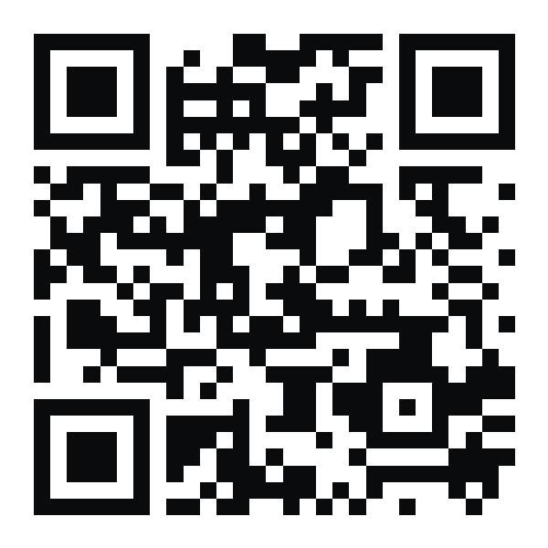

# Slate Studio 專業剪輯

- **手機下載頁**（掃上方 QR Code，任何網路皆可）：https://job159.github.io/Slate-Studio/
- **直接下載最新 APK**：https://github.com/job159/Slate-Studio/releases/latest/download/SlateStudio.apk

Android 10 以上的多軌影片剪輯 App：關鍵影格、轉場、特效、濾鏡與 LUT、文字花字、貼圖、色度去背、遮罩與混合模式、原創配樂與音效、錄音旁白，匯出 4K MP4、GIF、M4A／WAV。

安裝：下載 → 開啟 `SlateStudio.apk` → 允許「安裝未知應用程式」→ 若 Play 安全防護詢問，選「更多詳細資料 → 仍要安裝」。日後更新直接覆蓋安裝即可。

App 不需要網路、不收集或上傳任何資料。本倉庫只提供安裝檔（原始碼未公開）。

---
內建配樂、音效、貼圖、轉場、特效與濾鏡皆為原創內容，可自由用於你的影片（含商業用途）。字型以 SIL Open Font License 1.1 / Apache License 2.0 授權。
